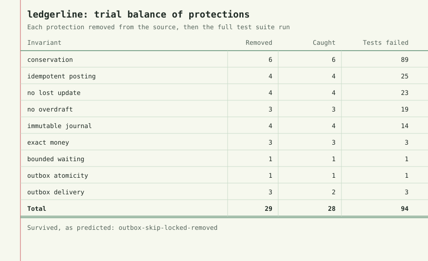
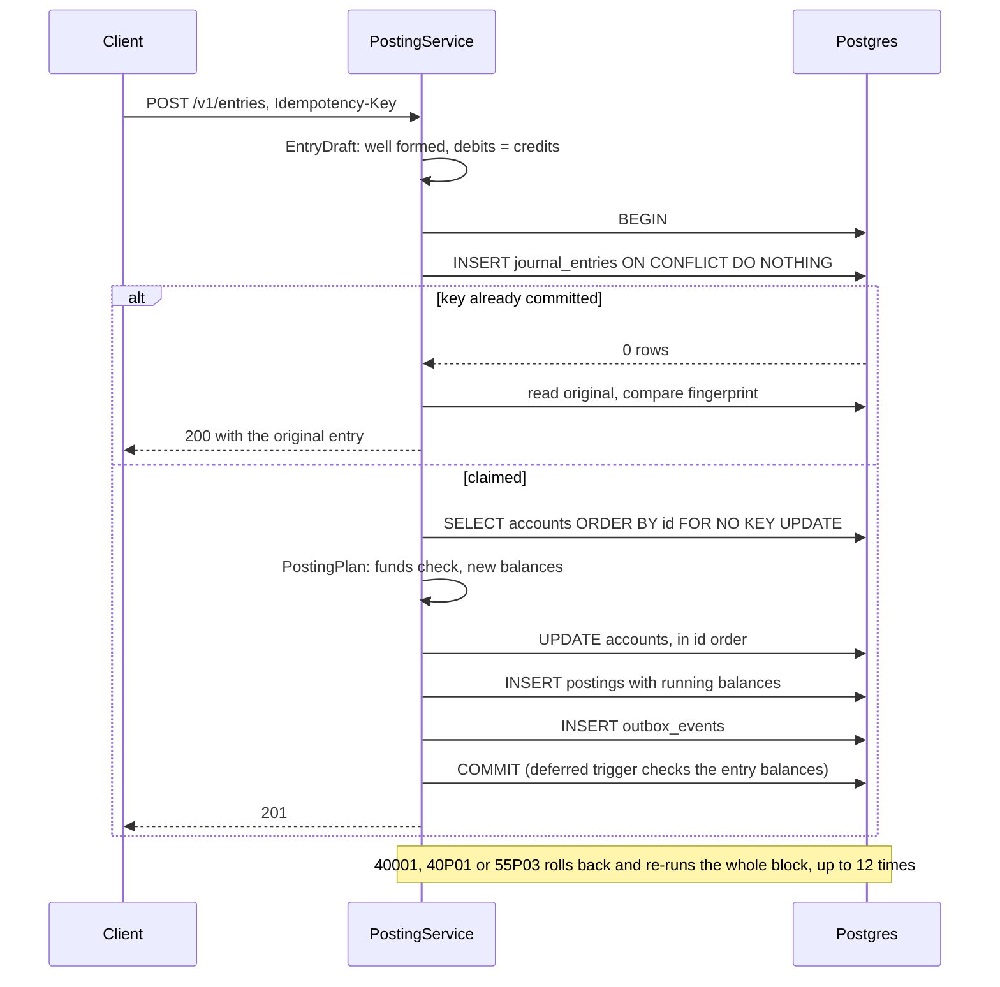
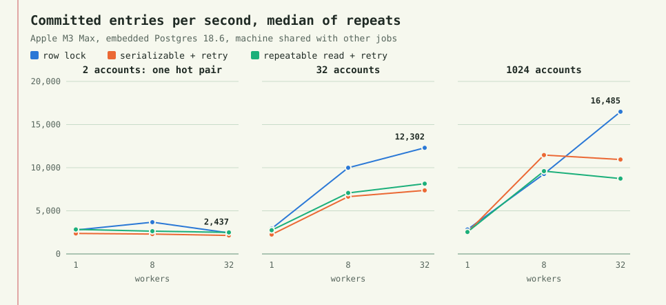

# ledgerline

[](https://github.com/matejpopovski/ledgerline/actions/workflows/ci.yml)

A double-entry ledger API in Spring Boot and Postgres, built around one question: do the
bookkeeping rules still hold when every request hits the same account at the same moment?

Passing tests do not answer that, because a concurrency test can pass by luck. So each protection
in this repo was deleted from the source, one at a time, and the test suite was run against the
damaged code. The sheet below is drawn from that run.



29 protections were removed, one patch each. Tests named in advance caught 28 of them, and the
suite passed 3 clean runs first. The one survivor was predicted, and is explained below. All 5
mutants that depend on thread timing were caught in 3 of 3 trials. Separately, 135 benchmark runs
over about 5 million journal entries each ended with a clean audit: no drift, no overdraft, no
unbalanced entry.

## The rules, and what enforces each one

Each rule has two layers on purpose. The service layer gives a caller a useful refusal. The
database layer holds for a psql session, a bad migration, and a bug in the service.

| Rule | Service | Database | Test that fails without it |
| --- | --- | --- | --- |
| Debits equal credits, in every entry | `EntryDraft` refuses at construction | Deferred constraint trigger checks at COMMIT | `theDatabaseRefusesAnUnbalancedEntryAtCommit` |
| A key moves money at most once | Claim the key first, compare request fingerprint | `UNIQUE (idempotency_key)` | `concurrentDuplicatesPostOnceAndAllSeeTheSameEntry` |
| No overdraft | `Account.balanceAfter` under a row lock or a conflict check | `CHECK (overdraft_allowed OR balance_minor >= 0)` | `racingWithdrawalsCannotSpendTheSameMoneyTwice` |
| The journal never changes | There is no update path; corrections are reversal entries | Triggers refuse UPDATE, DELETE and TRUNCATE | `theDatabaseRefusesEveryKindOfEdit` |

A fifth check sits outside the write path. `GET /v1/audit` recomputes every balance from the
journal, walks each account's running balance, and reports any disagreement.

## What makes this hard

**A constraint on a stored balance only protects the stored number.** Two withdrawals of 100 from
an account holding 100 can both read 100 and both write 0. The CHECK constraint sees 0 twice and
is satisfied, and 100 has been spent twice. The balance has to be read and written under
protection, and `balance_after_minor` on each posting exists so the audit can catch this if it
ever happens: the chain of running balances breaks at the exact posting.

**Key checks and funds checks have an order.** If the funds check runs first, a retry of a
payment that succeeded sees its own debit and answers "insufficient funds" to a client whose money
already moved. So the first statement of every posting inserts the journal header with
`ON CONFLICT DO NOTHING`. A duplicate blocks on that unique index until the first request commits
or rolls back, and only the winner goes on to touch balances. Reversing that order is the
`idempotency-claim-after-funds-check` mutant, and 14 tests fail.

**The obvious idempotency code passes every sequential test.** A SELECT followed by an INSERT
behaves perfectly until two requests arrive together. The `idempotency-check-then-insert` mutant
does exactly that. No sequential test fails. Two concurrent tests do, under row locks, in 3 of 3
trials.

**Failures arrive after the work is done.** Under SERIALIZABLE, COMMIT itself can fail after every
statement succeeded, so the unit of retry has to be the whole transaction, re-reading everything.
`aFailureAtCommitIsRetriedLikeAnyOther` builds a real write skew to prove that path runs.

## Money is a long

Amounts are integer minor units in a Java `long` and a Postgres `bigint`, and the API speaks the
same integers. 1050 means 10.50 USD and 1050 JPY; a currency's exponent matters only when showing
a number to a person, which is the one place `BigDecimal` appears (`MinorUnits.display`).

`BigDecimal` for the arithmetic was the alternative, and it was rejected because a ledger only
adds and compares. Integers do both exactly, compare with `==` where `BigDecimal` makes 1.0 and
1.00 unequal, need no scale policy, and map onto a one-line CHECK constraint. It would earn its
place in a system that multiplies, such as interest or FX, and this one does not.

Amounts and balances are capped at 2^53 - 1. Above that, a JSON number parsed into an IEEE double
by a JavaScript client silently rounds. The API also refuses decimals and strings rather than
coercing them: Jackson's default would turn `10.5` into `10`. Both have mutants.

## How a posting runs



The outbox row commits with the entry, so an entry cannot exist without its event. A relay
then leases due events with `FOR UPDATE SKIP LOCKED`, delivers them to a webhook with no
transaction open, and marks them published. Delivery is at least once.

## Removing each protection

`mutants/` holds 29 ordinary patches, each of which removes one thing: a check, a
constraint, a lock, a retry. There are no switches in the production code. `scripts/prove_mutants.py`
applies a patch to a copy of the tree, runs the whole suite, and records which tests failed in
`results/mutation-proofs.json`. A mutant counts as caught only if a test named in advance in
`mutants/manifest.json` fails, so one that dies for an unrelated reason is flagged, and one that
does not compile aborts the run. Mutants that depend on timing get two more runs of the relevant
tests, and the suite must pass three times first.

| Protection removed | Mutant | Tests failed | Timing trials |
| --- | --- | ---: | ---: |
| Row lock on account rows | `lock-row-lock-removed` | 8 | 3 of 3 |
| Canonical lock order | `lock-order-removed` | 2 | 3 of 3 |
| Serializable isolation, down to READ COMMITTED | `serializable-downgraded` | 8 | 3 of 3 |
| The retry loop | `retry-removed` | 14 | |
| Idempotency key | `idempotency-none` | 20 | |
| Unique index on the key, SELECT check left in place | `idempotency-check-then-insert` | 2 | 3 of 3 |
| Overdraft check, service layer only | `overdraft-no-domain-check` | 13 | |
| Overdraft check, database layer only | `overdraft-no-db-check` | 1 | |
| Overdraft check, both layers | `overdraft-no-check-at-all` | 19 | |
| Append-only triggers on postings | `immutable-postings-unguarded` | 4 | |
| Same-transaction outbox write | `outbox-dual-write` | 1 | |

All 29 are in `results/mutation-proofs.md`, and the failing test names in
`results/mutation-proofs.json`. Removing one layer of a two-layer rule is caught on its own,
so neither layer is decoration.

`outbox-skip-locked-removed` survives, as predicted before the run. Without SKIP LOCKED a second
relay waits, then re-checks the row, sees the lease and moves on. That is slower and just as
correct, so no test should fail.

The first pass of this harness was not clean, and that was its most useful output:

- `audit-without-snapshot` survived, which showed a claim in the code was wrong. A comment said
  the audit needed one snapshot or it would raise false drift alarms, but each comparison is a
  single SQL statement and cannot disagree with itself. What the snapshot really buys is that the
  counts and totals in one report describe one instant. The comment was corrected and a new test
  checks exactly that, catching the mutant in 3 of 3 trials.
- `lock-order-removed` ran into the 10-minute limit instead of failing, because each deadlock
  cost a one-second `deadlock_timeout` while the retries kept going. One trial of
  `serializable-downgraded` hung the same way, stuck inside the mixed-strategy test; the cause of
  that one was not pinned down. Test Postgres now detects deadlocks in 100 ms and racing threads
  are bounded, so a stuck racer fails with its stack trace. Neither has hung since, and the
  correct code passed 6 more rounds of the concurrency tests with no hang.
- Two immutability mutants were flagged as caught by an unexpected test, because JUnit's default
  name for a parameterized test did not contain the method name. That one was the harness.

## Row locks or retries

`ledger.strategy` selects how concurrent writers to one account are kept apart. Row locks are the
default because of this chart. Each worker posts two-leg transfers between random accounts through
the real `PostingService` in a closed loop, with no HTTP in the path.



| Accounts | Workers | Row lock | Serializable | Repeatable read | p99 ms, row lock / serializable | Gave up, row lock / serializable / repeatable read |
| ---: | ---: | ---: | ---: | ---: | ---: | ---: |
| 2 | 1 | 2,775 | 2,373 | 2,842 | 0.6 / 1.3 | 0 / 0 / 0 |
| 2 | 8 | 3,679 | 2,307 | 2,637 | 24.1 / 32.2 | 0 / 219 / 214 |
| 2 | 32 | 2,437 | 2,145 | 2,496 | 56.4 / 209.3 | 0 / 1205 / 1182 |
| 32 | 1 | 2,935 | 2,244 | 2,753 | 0.6 / 1.2 | 0 / 0 / 0 |
| 32 | 8 | 9,996 | 6,643 | 7,070 | 2.7 / 10.9 | 0 / 0 / 0 |
| 32 | 32 | 12,302 | 7,370 | 8,143 | 19.9 / 56.8 | 0 / 22 / 38 |
| 1024 | 1 | 2,830 | 2,515 | 2,541 | 0.6 / 1.3 | 0 / 0 / 0 |
| 1024 | 8 | 9,269 | 11,467 | 9,598 | 2.5 / 2.7 | 0 / 0 / 0 |
| 1024 | 32 | 16,485 | 10,942 | 8,740 | 12.9 / 12.0 | 0 / 0 / 0 |

Commits per second are medians of 3 repeats of 8 s each, with a fresh database per run, a shuffled
run order and the production retry policy. "Gave up" counts requests that spent all 12 attempts,
summed over the repeats, and p99 covers only requests that committed, which flatters the retrying
strategies. Every row, with ranges, is in `results/lock-strategies.md`; the raw runs are in
`results/lock-strategies.json`. All 81 runs ended with a clean audit, over 4,555,856 journal
entries in total.

**The load on the machine matters here.** This was an Apple M3 Max (14 cores, 36 GB) running other
jobs at the same time, with a load average between 6.4 and 15.7 at the start of a run and swap
nearly full. Individual repeats vary widely (32 accounts, 8 workers, row lock: 7,897 to 13,035).
Treat a gap under about 30 percent as noise and read the shape, not the digits. The 1024-account
row in particular does not show serializable beating row locks at 8 workers and losing at 32 in
any way that should be relied on.

What the runs show:

- **A hot account is a serial line.** With 2 accounts, 32 workers commit no more than 1 worker
  does, whichever strategy runs. The row stays locked through each commit.
- **Under moderate contention, row locks commit more and queue instead of failing.** At 32
  accounts they lead at both 8 and 32 workers, by about 1.5 times. On the hot pair at 32 workers
  all three commit at about the same rate, but serializable and repeatable read each gave up on
  about 1,200 requests, which a client sees as a 503, and row locks gave up on none. A row lock
  turns contention into a queue. A retry turns it into wasted work.
- **Retries cost little when conflicts are rare.** At 1024 accounts and 8 workers, under 2 percent
  of commits needed a retry.
- **SERIALIZABLE buys nothing here over REPEATABLE READ.** Every account an entry reads, it also
  writes, so all conflicts are write-write and snapshot isolation already catches them.
  `REPEATABLE_READ` passes every invariant test and the two track each other in the table.
  Serializable would matter if a rule spanned accounts without writing all of them, such as a
  limit shared across a group.

### What the fsync setting was hiding

Those runs use Postgres's macOS default, `wal_sync_method = open_datasync`, at about 0.3 ms per
commit. The [Postgres documentation](https://www.postgresql.org/docs/18/wal-reliability.html) says
write caching is prevented on macOS with `wal_sync_method = fsync_writethrough`, so the comparison
was run again that way, for 2 and 1024 accounts. Load average was lower for this run, 2.9 to 8.4.

| Accounts | Workers | Row lock | Serializable | Repeatable read | p99 ms, row lock / serializable | Gave up, row lock / serializable / repeatable read |
| ---: | ---: | ---: | ---: | ---: | ---: | ---: |
| 2 | 1 | 175 | 186 | 162 | 8.2 / 7.8 | 0 / 0 / 0 |
| 2 | 8 | 181 | 178 | 181 | 537.9 / 316.9 | 0 / 310 / 339 |
| 2 | 32 | 201 | 167 | 184 | 734.0 / 427.3 | 0 / 1562 / 1582 |
| 1024 | 1 | 174 | 171 | 169 | 7.4 / 8.4 | 0 / 0 / 0 |
| 1024 | 8 | 793 | 818 | 798 | 18.9 / 18.1 | 0 / 0 / 0 |
| 1024 | 32 | 2,833 | 2,924 | 2,805 | 27.8 / 26.4 | 0 / 5 / 0 |

One connection falls from about 2,800 to about 175 commits per second, which is about 5.7 ms per
flush, and that changes the conclusion in two ways. Throughput no longer separates the strategies
at all: the flush dominates. And it shows what a hot account really costs, because the row stays
locked through the flush: the hot pair stays near 180 per second at any worker count, while 1024
accounts reach about 2,800 at 32 workers, because group commit shares a flush among transactions
that do not touch the same rows. On a hot account the retry strategies gave up about 1,570 times
over the repeats, and needed more than 5 retries per commit. Row locks gave up on none, at the cost
of a 734 ms p99. All 54 runs ended with a clean audit (`results/lock-strategies-full-flush.md`).

## Run it

Requires JDK 22. Nothing else: tests and the local server use embedded Postgres 18.6, and no
Docker is involved.

```sh
./gradlew test                                        # 137 tests, about a minute
./gradlew bootTestRun --args='--server.port=18080'    # the service on a throwaway database
./scripts/demo.sh                                     # in another shell; needs curl and jq
```

`results/demo-session.txt` is a captured run of that script. A shortened piece of it:

```text
--- The client retries after a timeout: same key, same body
POST /v1/entries  ->  200
{"sequence":2,"replayed":true,"postings":[{"direction":"DEBIT","amountMinor":2550,"balanceAfterMinor":7450}, ...]}

--- Same key, different amount
POST /v1/entries  ->  409
{"code":"idempotency_key_reused","detail":"idempotency key was used for a different request"}

--- Alice tries to spend more than she holds
POST /v1/entries  ->  422
{"code":"insufficient_funds","detail":"account alice-1793620319 holds 7450, posting needs 999999"}
```

The build also runs `javac -Xlint:all -Werror`, Error Prone, and google-java-format through
Spotless. To regenerate the evidence:

```sh
python3 scripts/prove_mutants.py                      # about 30 minutes
./gradlew bench -PbenchArgs="--out results/lock-strategies.json"
./gradlew bench -PbenchArgs="--accounts 2,1024 --workers 1,8,32 --wal-sync-method fsync_writethrough --out results/lock-strategies-full-flush.json"
python3 scripts/render_figures.py
```

To run against a real database, set `LEDGER_DB_URL`, `LEDGER_DB_USER` and `LEDGER_DB_PASSWORD`
and use `./gradlew bootRun`. Flyway creates the schema. That path was not exercised for this
repository; everything measured here ran on embedded Postgres.

| Endpoint | Purpose |
| --- | --- |
| `POST /v1/accounts`, `GET /v1/accounts/{id}` | Open and read an account |
| `GET /v1/accounts/{id}/statement` | Postings with running balance, newest first, keyset paged |
| `POST /v1/entries`, `GET /v1/entries/{id}` | Post and read a journal entry; needs `Idempotency-Key` |
| `POST /v1/entries/{id}/reversal` | Post the mirror image of an entry, once |
| `GET /v1/audit` | Recompute everything from the journal |

The contract is `docs/openapi.json`, and a test fails if the running service drifts from it.
[docs/RUNBOOK.md](docs/RUNBOOK.md) covers what to watch and what to do when the audit is not clean,
requests get 503s or events stop arriving. Its SQL is executed by a test.

## Choices that were turned down

- **JPA.** The point of the project is what each statement locks and when. Hand-written SQL in
  `LedgerStore` keeps that on the page, where an ORM would keep it in a flush order.
- **Computing balances from the journal on demand.** Always right and O(postings) inside a lock.
  The stored balance is a cache that the audit checks against the journal.
- **A separate idempotency table.** A key column on the journal row commits atomically with the
  entry by construction, leaves no in-progress rows to expire, and means refused requests leave no
  trace, so their keys stay usable. The cost is that a rejected response is not replayed: a retry
  of a refused request is evaluated afresh.
- **A hash chain over the journal.** It would make tampering evident, but each entry would depend
  on its predecessor, forcing a global order on commits and giving up the group-commit scaling
  above.
- **Signed amounts.** A `direction` column plus a positive amount reads like a ledger, and the
  normal side of the account decides what a debit does to its balance.
- **Holding a transaction open during webhook delivery.** A slow receiver would pin a connection.
  A lease costs one extra UPDATE and makes a crashed relay's events reappear on their own.

## Limitations

- No authentication or tenancy. Idempotency keys are global across all callers.
- One currency per entry. An FX conversion would need two entries and a clearing account, and there
  is no support for that as one atomic operation.
- A reversal mirrors a whole entry; partial reversals are new entries.
- The append-only triggers bind everyone except the table owner, who can disable them (`AuditTest`
  does, to build damaged data). The service should connect as a non-owner role; this repo runs as
  the embedded superuser.
- Outbox delivery is at least once and unordered across retries. Receivers must deduplicate.
  Published rows are not pruned automatically.
- Keys never expire, so that unique index grows with the journal. There is no partitioning or
  archiving of old entries.
- `sequence` has gaps: a refused request burns an identity value. Do not use it as a gapless
  invoice number.
- Benchmarks are 8-second runs on a shared laptop, with the client on the same machine and no HTTP
  in the path. They compare strategies, not capacity, and there has been no multi-hour soak, so
  behaviour under long-term hot-row bloat is unmeasured.
- The audit scans whole tables and its cost grows with the journal.
- No crash or power-loss testing was done. Durability is whatever Postgres provides under the
  chosen `wal_sync_method`.
- Tested locally on macOS arm64 only. CI is configured for Linux x64 and Temurin 22, and the Linux
  binaries are pinned, but no run on GitHub has happened yet.

MIT licence, copyright 2026 Matej Popovski.
